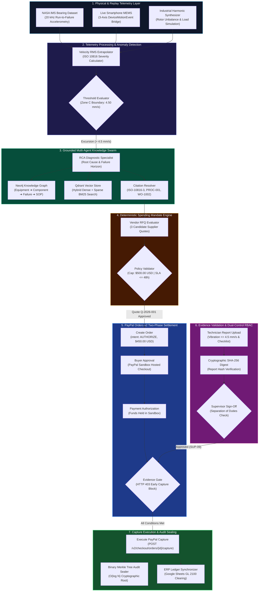
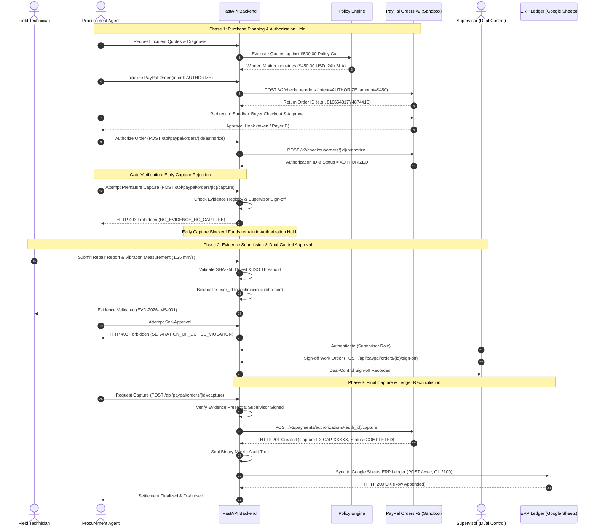
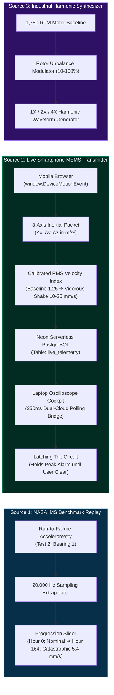
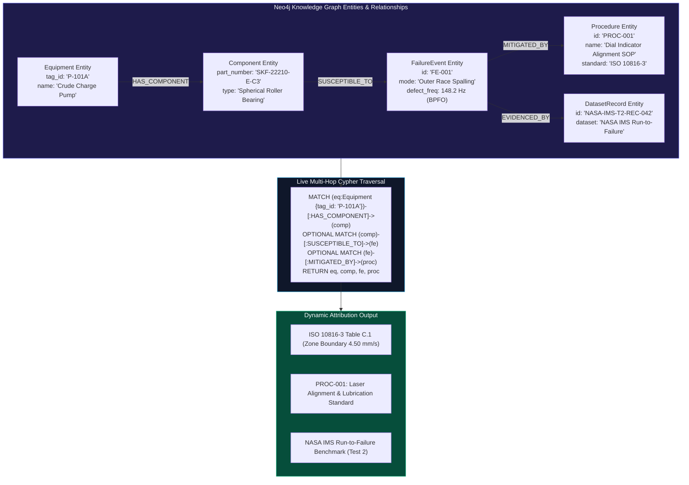
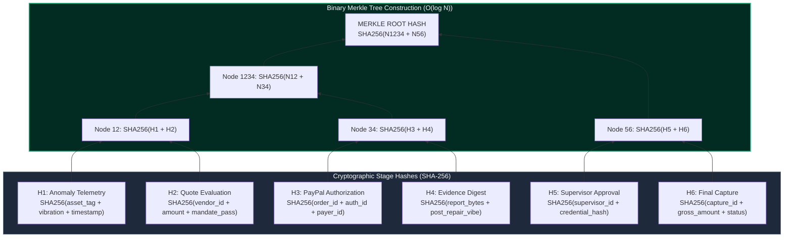
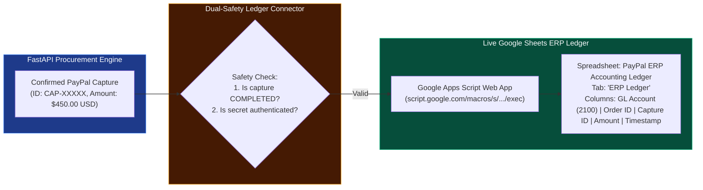

# KinetixRAG Enterprise & Agentic Commerce Architecture

**PayPal AI Hackathon 2026 — Primary Track: Best Use of Agentic Commerce**

This document provides the complete, authoritative architectural specifications, Mermaid sequence diagrams, state machines, and data topologies for **KinetixRAG**.

---

## 📑 Architecture Navigation Index

| Section | Architecture Diagram | Focus Area |
| :--- | :--- | :--- |
| **Section 1** | [End-to-End System Architecture](#1-end-to-end-system-architecture) | Full ingestion-to-settlement pipeline |
| **Section 2** | [PayPal Payment Lifecycle Architecture](#2-paypal-payment-lifecycle-architecture) | Two-phase authorization hold & evidence gating |
| **Section 3** | [Multi-Source Predictive Telemetry Architecture](#3-multi-source-predictive-telemetry-architecture) | NASA IMS replay, mobile MEMS & sensor bridge |
| **Section 4** | [Hybrid GraphRAG Knowledge Architecture](#4-hybrid-graphrag-knowledge-architecture) | Neo4j multi-hop traversal & citation grounding |
| **Section 5** | [Dual-Control Evidence & Merkle Lineage Architecture](#5-dual-control-evidence--merkle-lineage-architecture) | SHA-256 digest verification & binary Merkle tree |
| **Section 6** | [ERP Clearing & External Ledger Architecture](#6-erp-clearing--external-ledger-architecture) | Google Sheets GL 2100 clearing & SAP/Maximo connectors |

---

## 1. End-to-End System Architecture

The following diagram illustrates the complete flow of data from empirical sensor signals through multi-agent diagnosis, policy enforcement, PayPal Sandbox payment gating, and external ledger synchronization.

---

## 2. PayPal Payment Lifecycle Architecture

The core financial safety mechanism of KinetixRAG is the **Two-Phase Authorization Hold with Evidence Gating**.

---

## 3. Multi-Source Predictive Telemetry Architecture

KinetixRAG supports three distinct telemetry feeds while rigorously maintaining the boundary between real sensor data, simulated inputs, and historical reference benchmarks.

---

## 4. Hybrid GraphRAG Knowledge Architecture

The diagnostic intelligence is grounded in a multi-hop Neo4j knowledge graph linked with dense vector and sparse keyword retrieval.

---

## 5. Dual-Control Evidence & Merkle Lineage Architecture

To guarantee non-repudiation and prevent premature payment release, the complete audit lineage is sealed into a binary Merkle tree.

---

## 6. ERP Clearing & External Ledger Architecture

Once the PayPal capture is confirmed, KinetixRAG synchronizes settlement details to the general ledger clearing account.

