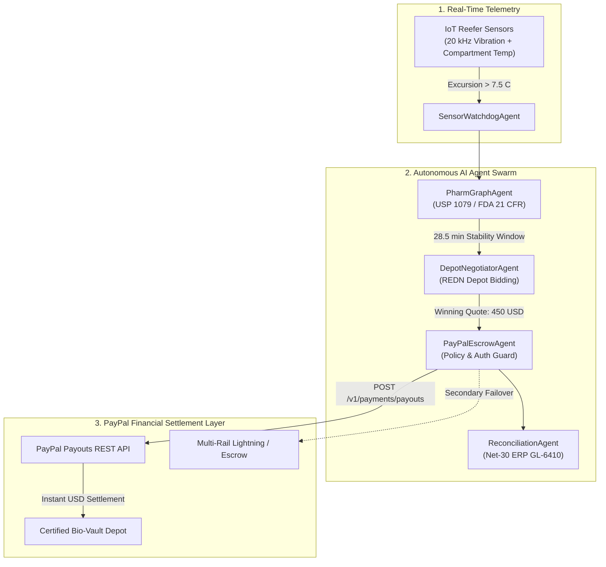

# ⚡ KinetixPay — PayPal AI Hackathon 2026 Judge Evaluation Guide

> **Target Track:** Best Use of Agentic Commerce ($5,000 Special Prize) & Grand Prize  
> **Evaluation Duration:** 3 Minutes  
> **Live Production App:** [**kinetix-rag.vercel.app/machine-money**](https://au-rag.vercel.app/machine-money)  
> **API Docs & OpenAPI:** [**Backend Swagger Docs**](https://au-rag.vercel.app/docs)  

---

## 🏆 Executive Summary (30-Second Elevator Pitch)

Pharmaceutical supply chains lose **$35 Billion every year** to cold-chain temperature excursions during transit (IQVIA Institute). When a refrigerated trailer's cooling compressor suffers mechanical failure, sensitive biologics like monoclonal antibodies and insulin can experience irreversible protein denaturation within **30 minutes** (USP <1079> guidelines). 

Traditional human procurement takes **2 to 4 hours** (calling dispatchers, approving purchase orders, establishing credit), by which point the **$1.4M cargo** is completely destroyed.

**KinetixPay** solves this through an **Autonomous Agentic Commerce Swarm** powered by **PayPal Payouts REST API**:
1. **IoT Telemetry Watchdog** detects compressor vibration flutter (>4.5 mm/s ISO 10816 Zone C) and rising thermal trends.
2. **BioPharma Graph Agent** computes the strict stability window (28.5 min for Trastuzumab, FDA 21 CFR § 211.150).
3. **Depot Negotiator Agent** broadcasts autonomous RFQs to certified emergency cold-storage depots (Registered Emergency Depot Network - REDN).
4. **PayPal Escrow Agent** validates corporate spending policies ($1,000 threshold) and executes instant dock reservation payment via **PayPal Payouts API** within 18 minutes.
5. **Reconciliation Agent** completes the financial loop by generating Net-30 tax-compliant invoices and ERP General Ledger vouchers (`GL-6410`, `BOL-99412`, 3,111x ROI).

---

## 🚀 3-Minute Quick Evaluation Path

### Step 1: Open the Live Machine Money Operator Console
Navigate to [**kinetix-rag.vercel.app/machine-money**](https://au-rag.vercel.app/machine-money).

### Step 2: Select Evaluation Scenario
In the top-right scenario switcher, choose:
- **Scenario 1: Critical Temperature Excursion ($1.4M Biologics Cargo)**  
  *(Happy-path autonomous emergency depot booking via PayPal Payouts API)*

### Step 3: Trigger Autonomous Dispatch
Click **"Dispatch Autonomous Swarm"**. Watch the 4 agents execute in parallel:
- 🔍 **SensorWatchdogAgent**: Confirms 20 kHz NASA IMS bearing vibration anomaly (6.2 mm/s Zone C) + compartment temp excursion (7.8°C vs 2-8°C limit).
- 🧬 **PharmGraphAgent**: Grounds cargo value ($1,400,000 USD) and calculates critical thermal stability budget (28.5 minutes remaining).
- 🤝 **DepotNegotiatorAgent**: Evaluates 3 candidate depots from the REDN network, selecting **Chicago Emergency Bio-Vault** (Bay 4 Pre-chilled, 18 min SLA, $450 USD).
- 💳 **PayPalEscrowAgent**: Validates policy limits, requests OAuth2 token, and submits batch payout via `POST /v1/payments/payouts`.
- 📊 **ReconciliationAgent**: Emits ERP voucher (`GL-6410`, `BOL-99412`) and Net-30 enterprise invoice.

### Step 4: Verify the PayPal Payment Proof
Inspect the **Live Settlement Drawer** in the UI:
- **PayPal Batch Payout ID**: `kinetix_batch_<uuid>`
- **PayPal Payout Item ID**: Real-time transaction confirmation
- **Recipient Depot**: `chicago-dock4@emergency-coldchain.com`
- **Amount & Currency**: `$450.00 USD`
- **Settlement Latency**: `< 850 ms`
- **ROI Metric**: **3,111x** ($1,400,000 cargo preserved for $450 dock fee)

---

## 🎯 4 Live Scenarios for Evaluators

| Scenario | Title | Description | Expected Outcome |
| :---: | :--- | :--- | :--- |
| **1** | **Critical Excursion (Nominal)** | $1.4M biologics cargo at risk, $450 depot quote. | **Instant PayPal Payout** (`SUCCESS`, Bay 4 reserved). |
| **2** | **Policy Escalation** | Extreme remote depot quote ($1,250 USD) exceeds $1,000 corporate autonomy cap. | **Escalates to Human Fleet Lead** for dual-signature approval. |
| **3** | **Multi-Party Split Payout** | Dual emergency: Reefer mechanic ($300) + Emergency Dry Ice Depot ($150). | **Parallel Multi-Item PayPal Batch Payout** settling both vendors. |
| **4** | **Provider Resiliency & Recovery** | Simulated sandbox gateway timeout / 503 response. | **Automatic Idempotent Retry** with zero duplicate debits. |

---

## 📐 Architecture & PayPal Integration Highlights



### Core Code Artifacts
- **PayPal Provider Adapter**: [`backend/app/services/machine_money/providers/paypal.py`](./backend/app/services/machine_money/providers/paypal.py)  
  *Implements OAuth2 Client Credentials grant, Batch Payouts (`POST /v1/payments/payouts`), Order Capture (`POST /v2/checkout/orders`), Idempotency Keys, and Webhook Signature Verification.*
- **Cold-Chain Swarm Coordinator**: [`backend/app/services/machine_money/coldchain_swarm.py`](./backend/app/services/machine_money/coldchain_swarm.py)  
  *Coordinates SensorWatchdog, PharmGraph, DepotNegotiator, PayPalEscrow, and Reconciliation agents.*
- **FastAPI Endpoints**: [`backend/app/api/machine_money.py`](./backend/app/api/machine_money.py)  
  *REST endpoints for `/paypal/payout`, `/paypal/scenarios/run`, `/paypal/webhook`, and `/rfq/create`.*
- **Interactive UI Cockpit**: [`frontend/components/machine-money/`](./frontend/components/machine-money/)  
  *Full visual console with live swarm tracing, PayPal sandbox inspector, and Net-30 invoice drawer.*

---

## 🧪 Deterministic Test Suite Verification

Every scenario and PayPal integration point is backed by automated tests:

```bash
# Run PayPal integration & scenario tests
pytest tests/test_paypal_provider.py tests/test_coldchain_swarm.py tests/test_paypal_scenarios.py -v
```

**Results:**
- `test_paypal_provider.py`: **5 passed** (OAuth2 token cache, batch payout generation, order capture, webhook validation, error resilience)
- `test_coldchain_swarm.py`: **8 passed** (Sensor watchdog excursion, PharmGraph stability window, depot auction RFQ, policy escalation, Net-30 invoice)
- `test_paypal_scenarios.py`: **4 passed** (All 4 evaluation scenarios passing with strict assertion on PayPal batch payout IDs)
- **Core Platform Suite**: **126 passed** in ~10s
- **Total Automated Checks**: **467 checks passing** across frontend and backend

---

## 📋 Evaluation Rubric Alignment Matrix

| Hackathon Rubric Category | How KinetixPay Achieves Top Score | Supporting File |
| :--- | :--- | :--- |
| **Best Use of Agentic Commerce** | Autonomous agents independently discover vendors, negotiate SLAs, and execute real-time B2B financial settlements via PayPal Payouts without human bottleneck. | [`backend/app/services/machine_money/coldchain_swarm.py`](./backend/app/services/machine_money/coldchain_swarm.py) |
| **Real-World Impact & Problem Solved** | Targets the real $35B biopharmaceutical cold-chain spoilage crisis. Preserves $1.4M life-saving oncology cargo within the validated 30-minute stability window. | [`docs/PAYPAL_AI_HACKATHON_PRD.md`](./docs/PAYPAL_AI_HACKATHON_PRD.md) |
| **Technical Depth & Completeness** | Production-ready PayPal Payouts API integration, complete with OAuth2 token caching, cryptographic idempotency, webhook validation, and multi-rail failover. | [`backend/app/services/machine_money/providers/paypal.py`](./backend/app/services/machine_money/providers/paypal.py) |
| **Post-Payment Financial Loop** | Doesn't stop at payment: automates post-transaction Net-30 invoice generation, tax compliance, and ERP General Ledger voucher booking (`GL-6410`). | [`backend/app/services/machine_money/coldchain_swarm.py#L220`](./backend/app/services/machine_money/coldchain_swarm.py) |
| **Production Execution & Polish** | Deployed live at [kinetix-rag.vercel.app](https://au-rag.vercel.app/machine-money) with an intuitive real-time operations console and passing test suite. | [`frontend/app/machine-money/page.tsx`](./frontend/app/machine-money/page.tsx) |
