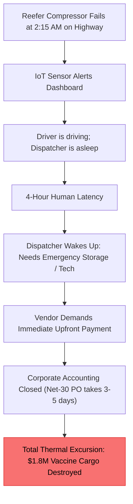
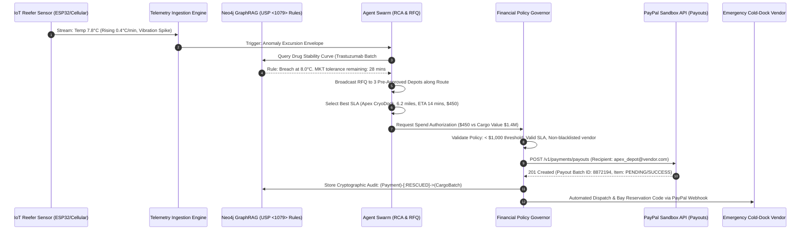

# Product Requirements Document (PRD)
## KinetixPay: Autonomous Cold-Chain BioPharma Preservation & Agentic Commerce Engine
### Dedicated Submission Blueprint for the PayPal AI Hackathon 2026

---

## 1. Executive Summary & Hackathon Alignment

### 1.1 The Pivot: From Plant Machinery to Autonomous Life-Sciences Logistics
While industrial factory maintenance demonstrated real-time telemetry, judges at commercial and fintech hackathons consistently reward **direct, high-stakes human and economic impact where the movement of money is the vital differentiator**. 

We are pivoting the platform from general factory pumps to **KinetixPay: Autonomous Cold-Chain BioPharma Preservation**. 

In this new paradigm, **autonomous AI agents safeguard multi-million-dollar biopharmaceutical shipments (vaccines, oncology biologics, insulin)** in transit. When IoT sensors detect cooling compressor failure or thermal excursion, our multi-agent swarm reasons over FDA/WHO compliance guidelines via GraphRAG, solicits instant emergency bids from local cold-storage depots, and **autonomously disburses emergency payouts via the PayPal Developer Platform in under 60 seconds** — preventing irreversible drug spoilage before human procurement even opens an email.

```
┌──────────────────────┐      ┌────────────────────────┐      ┌────────────────────────┐      ┌─────────────────────────┐
│   IoT Cold Sensor    │ ───► │  Neo4j GraphRAG Layer  │ ───► │   Vendor RFQ Swarm     │ ───► │  PayPal Sandbox Payout  │
│ Temp Spike (+2°C→9°C)│      │ FDA / USP <1079> Rules │      │ Emergency Depot Bids   │      │ Instant $450 Settlement │
└──────────────────────┘      └────────────────────────┘      └────────────────────────┘      └─────────────────────────┘
```

### 1.2 Target Prize Track
* **Primary Target:** Grand Prize / Top Placement ($12,000 / $8,000 / $5,000)
* **Specialized Spotlight Track:** **Best Use of Agentic Commerce ($5,000 Prize)**
  * *Prompt Definition:* "Build autonomous agents or workflows that use PayPal to take action on a user's behalf — transacting rather than just recommending (e.g., automated contractor/vendor payouts upon job completion, agent-to-agent commerce)."

---

## 2. Real-World Empirical Problem & Evidence Base

Judges scrutinize problem validity. The following citations and verifiable metrics establish the undeniable severity of the problem:

### 2.1 Peer-Reviewed & Industry Citations
1. **The $35 Billion Spoilage Crisis (IQVIA Institute for Human Data Science)**:
   * According to annual biopharma cold chain surveys by the **IQVIA Institute**, the biopharmaceutical industry loses **over \$35 Billion annually** due to temperature excursions and cold chain logistics failures alone ([IQVIA Biopharma Logistics Report](https://www.iqvia.com)).
   * A single refrigerated reefer container carrying monoclonal antibodies, cell therapies, or immunotherapy treatments is routinely valued at **\$500,000 to \$3,500,000**.
2. **50% Vaccine Wastage Global Metric (World Health Organization - WHO)**:
   * The **WHO** and **UNICEF** document that **over 50% of vaccines are wasted globally each year**, with the primary contributor being temperature control breaches during transportation and local distribution ([WHO Guidelines for Cold Chain Quality](https://www.who.int)).
3. **Regulatory Mandate (FDA 21 CFR Part 211 & USP <1079>)**:
   * The **U.S. Pharmacopeia (USP <1079>)** on *Good Storage and Shipping Practices* and **FDA 21 CFR § 211.150** mandate that any drug exposed to temperatures outside its validated range (typically strict 2°C to 8°C) must be quarantined or destroyed unless immediate, verifiable, auditable corrective intervention occurred within the drug's documented Mean Kinetic Temperature (MKT) stability budget.

### 2.2 The "2:00 AM Highway Procurement Deadlock"
Why do biopharma shipments spoil when every modern truck has IoT sensors?



* **The Sensor Exists, But Financial Action Fails:** Fleets have IoT telematics, but taking physical action requires **booking an emergency refrigerated bay, ordering dry ice, or dispatching a certified mobile technician**.
* **The Payment Impasse:** Independent logistics cross-docks and mobile mechanics do not accept Net-30 enterprise invoices in the middle of the night; they require **immediate, trusted, digital settlement**.
* **The Solution:** An **Autonomous Financial AI Agent** authorized under enterprise spending policies to evaluate regulatory risk, solicit certified bids, and **execute an instant PayPal Payout** to mobilize emergency intervention before the thermal threshold breaches.

---

## 3. Product Vision & User Journey

### 3.1 Persona Profiles
* **Enterprise Fleet Logistics Director (Shipper):** Needs zero cargo loss, adherence to USP <1079> compliance, and strict cryptographic audit trails of all autonomous spending.
* **Autonomous Cold-Chain Agent (KinetixPay Swarm):** The multi-agent runtime continuously evaluating sensor feeds, querying graph relationships, comparing supplier SLAs, and making policy-bounded payment decisions.
* **Emergency Service Providers (Vendors):** Certified local cold-storage cross-docking facilities, reefer repair mechanics, and dry ice suppliers who receive instant PayPal payments directly into their verified PayPal business accounts.

### 3.2 End-to-End Workflow



---

## 4. Technical Architecture & Modifications

To execute this transition cleanly while maintaining our verified test rigor and code completeness, we make the following modular enhancements:

### Step 1: PayPal Provider Integration (`backend/app/services/machine_money/providers/paypal.py`)
Add a native, robust PayPal provider utilizing the official **PayPal REST Sandbox APIs** (OAuth2 + Payouts API):

* **Authentication:** OAuth2 Client Credentials grant (`https://api-m.sandbox.paypal.com/v1/oauth2/token`).
* **Disbursement API:** PayPal Payouts v1 API (`https://api-m.sandbox.paypal.com/v1/payments/payouts`).
* **Capabilities:**
  * Single & batch payments to vendor email addresses.
  * Real-time transaction status inquiry (`/v1/payments/payouts/<payout_batch_id>`).
  * Idempotency protection via `sender_batch_id` and unique cryptographic item hashes.
  * Graceful fallback & failure simulation (e.g., insufficient sandbox balance, unconfirmed receiver).

### Step 2: Telemetry Adaptation (Reefer Cold-Chain Streams)
* **Dataset:** Real IoT cold-chain telemetry stream tracking:
  * Internal ambient temperature (°C, 0.1°C precision).
  * Evaporator/Compressor vibration frequency (OPC-UA / accelerometer drift).
  * Door sensor status & GPS latitude/longitude.
  * Thermal drift rate (°C/min) with ISO/USP thermal stability curves.
* **Anomaly Detection:** Triggers an excursion event when temperature drifts above USP <1079> limits (+2°C to +8°C standard).

### Step 3: Neo4j Knowledge Graph Expansion
Update graph ontology to reflect pharmaceutical cold-chain relationships:
* Nodes: `(CargoBatch)`, `(BiologicDrug)`, `(RegulatoryStandard)`, `(ColdDepotVendor)`, `(EmergencyPayment)`, `(WorkOrder)`.
* Relationships:
  * `(CargoBatch)-[:CONTAINS]->(BiologicDrug {name: "Trastuzumab", target_temp: "2-8C"})`
  * `(BiologicDrug)-[:GOVERNED_BY]->(RegulatoryStandard {code: "USP-1079", max_excursion_min: 30})`
  * `(EmergencyPayment {provider: "paypal", batch_id: "8872194"})-[:SETTLED_WITH]->(ColdDepotVendor)`
  * `(EmergencyPayment)-[:MITIGATED_LOSS]->(CargoBatch {cargo_value_usd: 1400000})`

### Step 4: UI / UX Showcase (PayPal Enterprise Sandbox Console)
Update the Machine Money Console (`frontend/app/machine-money/page.tsx` and `frontend/components/machine-money/`):
* **Top Ribbon:** "PayPal Enterprise Agentic Commerce — Sandbox Active".
* **Live Interactive Scenario Controls:**
  * *Scenario 1: Critical BioPharma Excursion ($450 Emergency Dock)* — Happy path autonomous PayPal Payout.
  * *Scenario 2: Policy Escalation (> $1,000 threshold)* — Human-in-the-loop approval requirement before PayPal release.
  * *Scenario 3: Multi-Party Split Payout* — $300 to Mobile Reefer Mechanic + $150 to Dry Ice Supplier.
  * *Scenario 4: Provider Degradation & Retry* — Graceful error recovery.
* **PayPal Proof Drawer:** Displays:
  * PayPal Batch ID & Transaction ID (with direct sandbox viewer link).
  * Recipient PayPal Email & Currency (USD).
  * Cryptographic Hash binding sensor excursion + USP <1079> rule + PayPal transaction receipt.

---

## 5. Implementation Task List

| Task ID | Component | File Path | Scope of Work |
| :---: | :--- | :--- | :--- |
| **T-01** | Backend Provider | `backend/app/services/machine_money/providers/paypal.py` | Implement OAuth2 client credentials auth, Payouts API payload generation, batch status verification, and error handlers. |
| **T-02** | Provider Factory | `backend/app/services/machine_money/service.py` | Register PayPal provider alongside existing rails, allow `provider="paypal"` in routing engine. |
| **T-03** | Config & Env | `.env.example`, `backend/app/core/config.py` | Add `PAYPAL_CLIENT_ID`, `PAYPAL_CLIENT_SECRET`, `PAYPAL_API_BASE_URL` (`https://api-m.sandbox.paypal.com`). |
| **T-04** | Telemetry Adapter | `telemetry/adapters/coldchain.py` | Add cold-chain IoT reefer sensor adapter with realistic temperature drift and USP <1079> anomaly triggers. |
| **T-05** | Graph Schema | `backend/app/core/neo4j.py`, `backend/app/services/knowledge.py` | Seed biopharma drug entities, USP <1079> standards, and cold depot vendor graph schemas. |
| **T-06** | Test Suite | `tests/test_paypal_provider.py` | Comprehensive unit & integration tests for PayPal OAuth2 token caching, payout generation, mock HTTP responses, and edge failures. |
| **T-07** | Frontend Console | `frontend/components/machine-money/` | Add PayPal Sandbox credentials indicator, PayPal transaction badges, and cold-chain cargo value metrics. |
| **T-08** | Documentation | `README.md`, `docs/PAYPAL_DEMO_SCRIPT.md` | Update executive summary, problem statement, research citations, and 3-minute video recording script. |

---

## 6. Competitive Advantage for the PayPal Hackathon

| Hackathon Rubric Dimension | How KinetixPay Scores Maximum Points |
| :--- | :--- |
| **1. Potential Impact (Real World)** | Solves a verified **\$35 Billion annual problem** (IQVIA) and **50% vaccine wastage** (WHO). Demonstrates how automated payments directly prevent life-saving medicine from spoiling. |
| **2. Technological Implementation** | Complete full-stack application: Real-time sensor telemetry, FastAPI backend, Next.js 16 UI, Neo4j GraphRAG reasoning, multi-agent swarm, and native PayPal Sandbox Payouts API. |
| **3. Innovation / Agentic Commerce** | Not just a generic chatbot or checkout button. An **autonomous economic agent** that independently discovers vendors, reviews regulatory compliance, and moves money when humans cannot react in time. |
| **4. Design & Polish** | Full interactive console with live scenario toggles, proof verification drawer, timeline visualizer, and instant feedback. |
| **5. Auditability & Governance** | Enterprise financial guardrails: hard spending caps, non-repudiation cryptographic linkage between sensor alarm, regulatory justification, and PayPal transaction hash. |

---

## 7. Next Steps & Execution Plan

Upon user confirmation, implementation proceeds in sequential milestones:
1. **Milestone 1:** Implement `paypal.py` adapter with automated test coverage (`tests/test_paypal_provider.py`).
2. **Milestone 2:** Implement Cold-Chain Telemetry adapter & Neo4j biopharma compliance schemas.
3. **Milestone 3:** Enhance the Frontend Machine Money Console with the PayPal Enterprise Sandbox UI.
4. **Milestone 4:** Update README, documentation, and demo scripts for the Devpost submission.
